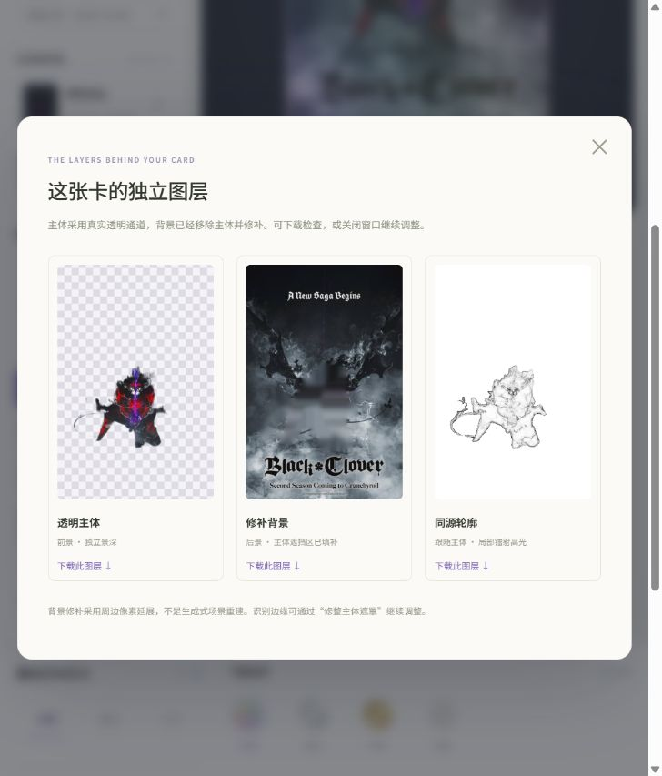

# 映卡 Holo Studio

上传图片，自动制作可旋转、可调整、可分享的 3D 全息闪卡。

## 在线体验

**网站：[https://ruic-holo-studio-1029.fondscarf23.chatgpt.site](https://ruic-holo-studio-1029.fondscarf23.chatgpt.site)**

无需安装软件即可上传制作。图像识别与编辑在浏览器内完成；发布成品时才上传作品。



## 功能

- 自动分离透明主体，修补被主体遮挡的背景，并提取与主体对齐的轮廓。
- 独立前景、背景、轮廓和可选特效图层，支持不同深度的视差与随观看角度变化的镭射材质。
- 切换全息、银箔、烫金和原画；调整景深、画面比例、闪点、边框、圆角和文字。
- 遮罩画笔精修主体，应用后重新制作背景与轮廓；各图层可单独下载。
- 自动保存本机草稿，导入、导出工程文件，导出高清 PNG。
- 登录后发布独立成品链接。访客可以观看，不能修改原草稿。
- 精细与轻量两种本机识别模式，适配手机和桌面。

## 制作流程与边界

`图片 → 本机模型分离主体 → 移除主体并修补背景 → 同源轮廓 → 图层视差与全息材质 → 调整 → 保存分享`

卡片由厚度、圆角和侧边几何体配合多个图层渲染。这里的立体感是分层视差，不是照片中物体的完整三维重建。

背景采用周边像素延展与平滑修补，不是生成式场景重建；大幅遮挡或复杂背景可能需要替换背景。低对比主体、毛发、透明物体和海报文字可能识别不完整，可以用遮罩画笔修整。本项目暂不自动生成 Blender 工程。

首次使用精细识别约需加载 56 MB 资源，轻量识别约 16 MB；后续通常可利用浏览器缓存。图像处理在本机运行，不需要图像服务 API 密钥。

## 本地运行

需要 Node.js **22.13.0 或更高版本**。支持 Windows、macOS 和 Linux。

```bash
npm ci
npm run dev
```

打开终端显示的地址，默认是 `http://localhost:5173`。模型与推理引擎已随源码提供，制作过程中无需从外部模型站点下载。

```bash
# 构建完整网站
npm run build

# 在本机运行已构建的 Worker
npm start
```

本地开发模式提供测试登录：访问 `/signin-with-chatgpt?return_to=/`。这只用于回环地址上的开发预览，生产登录由托管平台提供。

如需重新取得模型与运行引擎，可执行 `node scripts/prepare-layer-assets.mjs`。该脚本从上游发布地址下载并校验模型，同时保留许可证。

## 源码结构

| 路径 | 用途 |
| --- | --- |
| `public/studio/studio.js` | Three.js 卡片、材质、编辑、草稿和导出 |
| `public/studio/auto-layers.js` | 自动制作流程、进度、图层检查 |
| `public/studio/layer-worker.js` | 本机模型推理、背景修补、同源轮廓 |
| `public/studio/models/` | 开源模型、校验信息和许可证 |
| `app/api/cards/` | 发布成品与读取分享快照 |
| `app/c/[id]/` | 独立成品观看页 |
| `.openai/hosting.json` | 托管配置；本仓库不绑定原网站的项目 ID |

## 托管与分享

上方在线地址运行在 Sites。此 GitHub 仓库保存网站源码；推送 GitHub 不会自动更新该在线实例。

完整分享功能使用 Cloudflare Worker、`BUCKET` R2 对象存储绑定，以及 Sites 提供的 ChatGPT 登录身份。自行部署时需要配置这些服务，不能直接把完整应用当作纯静态 GitHub Pages 网站发布。

本仓库排除了密钥、本地环境、运行状态和构建缓存；原网站的项目身份与用户运行数据不包含在此源码副本中。

## 技术与致谢

- [Three.js](https://github.com/mrdoob/three.js)：WebGL 卡片几何体与材质，MIT 许可证。
- [U²-Net](https://github.com/xuebinqin/U-2-Net)：主体识别模型，Apache 2.0 许可证。
- [rembg](https://github.com/danielgatis/rembg)：模型分发与预处理参考。
- [ONNX Runtime Web](https://github.com/microsoft/onnxruntime)：浏览器内模型推理，MIT 许可证。
- Vinext、React、Cloudflare Workers 与 R2：网站和分享服务。

第三方许可证保留在 `public/studio/models/`、`public/studio/vendor/` 和 `vendor/` 中。演示图不代表官方授权或关联。
